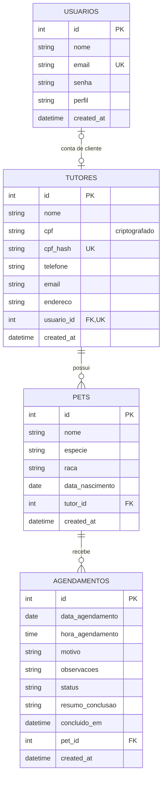

# Clube das Patas

Sistema web para organizar tutores, pets e agendamentos de uma clínica
veterinária. A aplicação oferece uma área administrativa para a equipe e um
portal separado para clientes.

## Documentação do sistema

Esta seção reúne a documentação funcional e técnica do projeto, substituindo o
antigo arquivo de documentação em PDF.

### Objetivo

Centralizar o cadastro de clientes e seus pets, organizar a agenda de
atendimentos e proteger as credenciais e os dados pessoais armazenados.

### Requisitos funcionais

| ID | Requisito |
| --- | --- |
| RF01 | Permitir que a equipe entre com e-mail e senha e receber uma mensagem quando a autenticação falhar. |
| RF02 | Permitir o cadastro público de uma conta de cliente vinculada a um tutor. |
| RF03 | Exibir no painel da equipe o nome do usuário autenticado, acesso aos módulos e opção para sair. |
| RF04 | Listar, pesquisar, cadastrar, editar e remover tutores pela área administrativa. |
| RF05 | A equipe pode ver todos os pets, inclusive os cadastrados no portal pelos clientes, pesquisar, cadastrar, editar e remover; cada pet deve estar associado ao tutor responsável. |
| RF06 | Listar agendamentos em ordem cronológica, exibindo informações do pet e do tutor. |
| RF07 | Permitir à equipe cadastrar, alterar data e horário, cancelar e concluir atendimentos, registrando um resumo do procedimento realizado. |
| RF08 | Permitir que o cliente consulte somente os pets e atendimentos associados à sua própria conta, veja a situação e o resumo dos atendimentos concluídos e cadastre seus pets. |
| RF09 | Permitir que o cliente encerre sua sessão. |

### Regras de negócio

- Um cliente cadastrado possui uma conta e um tutor associado; a criação dos
  dois registros é feita na mesma transação.
- A conta do cliente não pode escolher nem alterar o tutor associado ao
  cadastrar um pet.
- A equipe pode gerenciar tutores, pets e agendamentos; clientes são
  direcionados ao portal e não acessam as páginas administrativas.
- O CPF é informado no cadastro, criptografado antes de ser salvo e pesquisado
  por um HMAC, sem precisar comparar o valor em texto puro. O sistema não
  verifica os dígitos verificadores do CPF.
- O banco de demonstração contém pelo menos três registros iniciais em cada
  tabela criada pelo script.
- Pets e agendamentos referenciados não podem ser removidos enquanto houver
  registros dependentes.
- Somente a equipe pode concluir um atendimento; a conclusão exige um resumo
  do procedimento, registra data e hora e impede alterações ou cancelamento
  posteriores pela agenda.

### Requisitos de segurança e proteção de dados

- Senhas são armazenadas com `password_hash` e verificadas com
  `password_verify`.
- CPF é criptografado com AES-256-GCM. A variável `APP_KEY` deve ser secreta,
  aleatória e estável; se ela for perdida ou alterada, os CPFs já armazenados
  não poderão ser descriptografados.
- Consultas ao PostgreSQL usam parâmetros; saídas exibidas são escapadas como
  HTML; formulários de alteração usam tokens CSRF.
- A sessão usa cookie `HttpOnly`, `SameSite=Lax`, modo estrito e expira após
  uma hora de inatividade ou uma hora desde sua criação.
- As rotas administrativas e o portal verificam o perfil do usuário.
- A aplicação define cabeçalhos básicos de segurança, incluindo CSP e proteção
  contra enquadramento por outras páginas.
- Os dados fornecidos no script são demonstrativos. A implantação real deve
  definir gestão de chaves, controle de acesso, backups e retenção de dados; o
  projeto não constitui certificação jurídica de conformidade com a LGPD.

## Modelo de dados



Uma conta de equipe não precisa de tutor associado. Uma conta de cliente pode
estar vinculada a no máximo um tutor; tutores cadastrados pela equipe podem não
ter uma conta de cliente.

## Tecnologias e organização

- PHP 8.1 ou superior.
- PostgreSQL 13 ou superior.
- Extensões PHP `pdo_pgsql`, `openssl` e `mbstring`.
- Composer é opcional; o projeto inclui um autoloader PSR-4 local.
- O servidor web deve expor somente o diretório `public/`.

```text
Sistema/
├── config/                 # configuração da conexão com o banco
├── public/                 # pontos de entrada HTTP e arquivos estáticos
├── src/
│   ├── Controllers/        # login, cadastro, painel e módulos
│   ├── Core/               # sessão, segurança, conexão e autoload
│   ├── Models/              # consultas e acesso aos dados
│   └── Views/               # telas de autenticação, portal e layout
├── .env.example             # exemplo de variáveis para desenvolvimento
├── composer.json            # mapeamento PSR-4
└── saep_db.sql              # criação e carga inicial do banco
```

### Principais páginas

| Caminho | Acesso | Descrição |
| --- | --- | --- |
| `/login.php` | Público | Autenticação da equipe e de clientes. |
| `/cadastro.php` | Público | Cadastro de uma conta de cliente. |
| `/index.php` | Equipe | Painel principal da equipe. |
| `/tutores.php` | Equipe | Pesquisa e gerenciamento de tutores. |
| `/pets.php` | Equipe | Gerenciamento de pets. |
| `/agendamentos.php` | Equipe | Agenda e gerenciamento de atendimentos. |
| `/cliente.php` | Cliente | Portal com os próprios pets e atendimentos. |
| `/logout.php` | Autenticado | Encerramento da sessão. |

## Instalação e execução

1. Instale o PHP com as extensões listadas acima e o PostgreSQL.
2. Crie o banco:

   ```sql
   CREATE DATABASE saep_db;
   ```

3. A partir da pasta `Sistema/`, execute o script de criação e carga:

   ```powershell
   psql -U postgres -d saep_db -f saep_db.sql
   ```

   Para uma instalação existente, execute novamente o script para aplicar as
   migrações dos perfis de usuário e da associação de contas com tutores.

4. Configure as variáveis de ambiente `APP_KEY`, `DB_HOST`, `DB_PORT`,
   `DB_NAME`, `DB_USER` e `DB_PASSWORD`. O arquivo `.env.example` contém
   valores de exemplo; o PHP não carrega arquivos `.env` automaticamente.
   Não use a chave de exemplo em produção.
5. Inicie o servidor local a partir de `Sistema/`:

   ```powershell
   php -S 127.0.0.1:8000 -t public
   ```

6. Abra <http://127.0.0.1:8000>.

O Composer pode gerar o autoload com `composer install`. Sem Composer,
`src/Core/autoload.php` carrega as classes do projeto.

## Contas de demonstração

O script cria três contas da equipe:

- Administrador: `admin@clinica.com` — senha `1234`.
- Equipe: `carlos@clinica.com` e `ana@clinica.com` — senha `password`.

`1234` é uma senha fraca, disponível somente para demonstrar o login em ambiente
local. Altere as credenciais antes de disponibilizar o sistema.
Clientes podem criar sua própria conta em `/cadastro.php`.

## Banco de dados

O arquivo `saep_db.sql` cria as tabelas `usuarios`, `tutores`, `pets` e
`agendamentos`, seus relacionamentos, índices e registros iniciais. Também
define as regras de unicidade e impede a remoção de tutores ou pets que ainda
tenham registros dependentes.

## Verificação rápida

No PowerShell, a partir de `Sistema/`, valide a sintaxe dos arquivos PHP:

```powershell
Get-ChildItem src, public -Filter *.php -Recurse |
    ForEach-Object { php -l $_.FullName }
```

## Créditos e escopo

A organização em `config/`, `public/` e `src/` foi inspirada pelo padrão do
projeto de referência
[Diogotb/SAEP_2026 — Prova032026](https://github.com/Diogotb/SAEP_2026/tree/main/Prova032026).
O código, o modelo de dados e as funcionalidades do Clube das Patas são
próprios.
